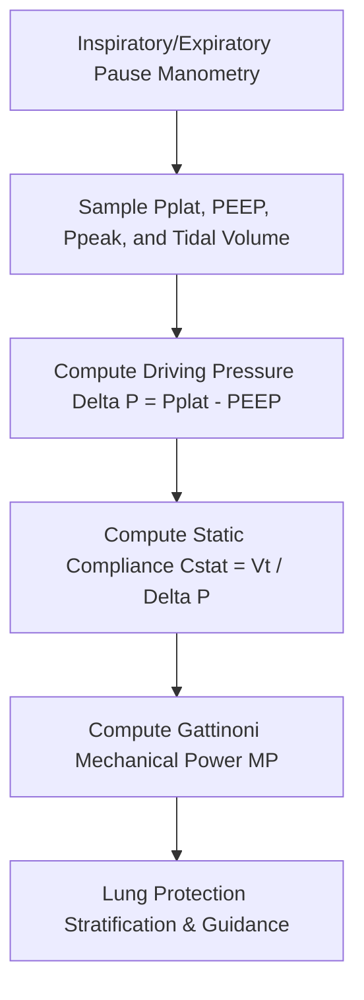

# Pulmonary Driving Pressure ($\Delta P$), Static Compliance & Mechanical Power Skill

[](LICENSE)
[](https://www.python.org/)
[](https://modelcontextprotocol.io/)
[](requirements.txt)
[](https://github.com/alphaparkinc)

A zero-dependency, mathematically rigorous personal agent skill that computes airway driving pressure, static respiratory compliance, and mechanical power of ventilation to prevent ventilator-induced lung injury (VILI).

## Architecture



## Quick Start

```python
from client import PulmonaryDrivingPressureClient

client = PulmonaryDrivingPressureClient()
result = client.evaluate_ventilation_stress(
    plateau_pressure_cmh2o=20.0,
    peep_pressure_cmh2o=10.0,
    peak_pressure_cmh2o=24.0,
    tidal_volume_ml=420.0,
    respiratory_rate_bpm=16.0
)
print("Driving Pressure (cmH2O):", result["mechanics"]["driving_pressure_delta_p_cmh2o"])
print("Static Compliance (mL/cmH2O):", result["mechanics"]["static_compliance_cstat_ml_cmh2o"])
print("Status:", result["clinical_safety_stratification"]["driving_pressure_status"])
```

## License
Apache-2.0
